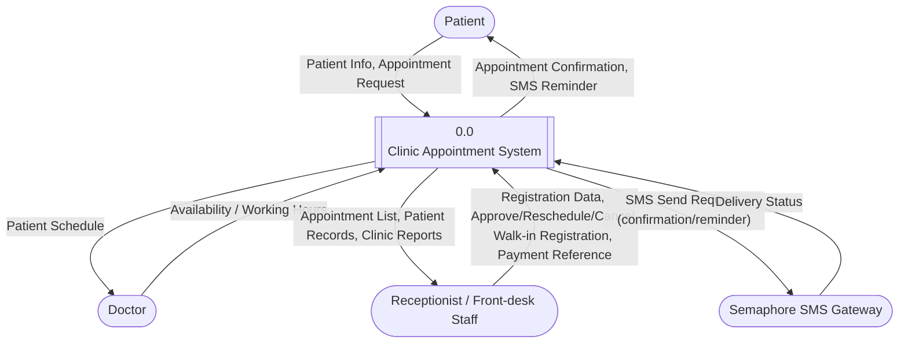
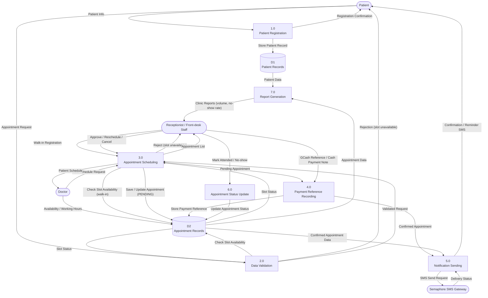
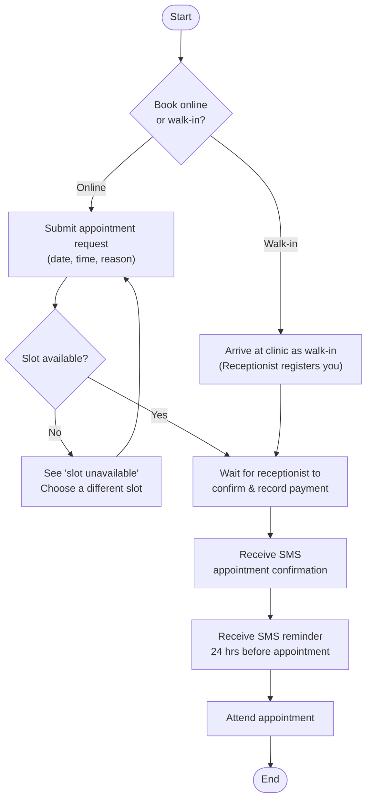
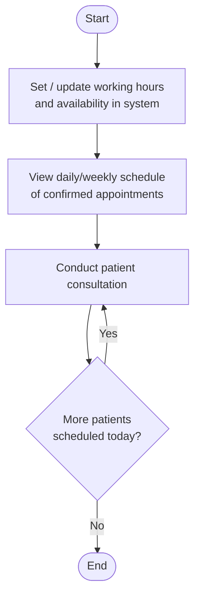
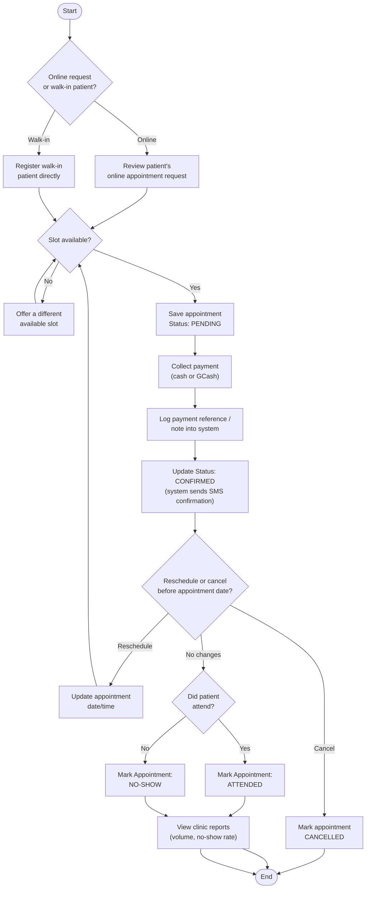

# Master Handoff — Clinic Appointment System

> **Purpose of this document:** This is the complete design context for a Clinic Appointment System, produced during a System Integration and Architecture course project. It is meant to be pasted into a **new chat** to continue the work — specifically, moving from design into actual implementation ("vibe coding" the real system). Everything below is the accumulated, final, decided state of the design — not a draft. No hypothetical/fictional clinic scenario is used; this describes the actual system to be built.

**Team:** Hamid, Kurt, Kristoffer
**Course context:** System Integration and Architecture — design phase is complete; next phase is implementation.
**Intended build approach:** AI-assisted ("vibe coding") using Claude as a conversational coding partner inside a local dev environment (VS Code + Git + Supabase console + local Next.js server) — not a hosted AI app-builder like Lovable.dev/Bolt.new. See "AI Tooling & Development Strategy" section below for the full reasoning already agreed on.

---

## 1. System Purpose

A web-based appointment management system for a small, single-doctor general medical clinic. The clinic currently manages appointments manually (phone calls, walk-ins, a paper logbook), which causes double-bookings, missed reminders, and no digital record of patient visit history. The system replaces this with:

- Online appointment requests with real-time availability checking
- Walk-in registration support
- SMS appointment confirmations and 24-hour reminders
- Simple manual payment-reference logging (no payment gateway integration)
- Attendance tracking (attended / no-show)
- Basic operational reporting

The design is intentionally scoped for a **small clinic** — one doctor, a small front-desk staff — not a hospital or multi-branch system. Every design decision below optimizes for that scale and for low operational cost.

---

## 2. Stakeholders (final — 3 only)

| Stakeholder | Responsibilities |
|---|---|
| **Patient** | Requests appointments (online or walk-in), receives SMS confirmations/reminders, pays consultation fee (cash or GCash) |
| **Doctor** | Sets availability/working hours, views daily/weekly schedule of confirmed appointments, conducts consultations |
| **Receptionist** | Registers patients, manages/approves/reschedules/cancels appointments, registers walk-ins, records payment reference, marks attendance, views operational reports |

**Note:** Earlier drafts included a "Clinic Owner" and "System Admin" stakeholder — both were deliberately removed to keep scope tight. Reporting (originally for the Owner) is now consumed by the Receptionist instead.

---

## 3. Scope

### In Scope
- Online appointment requests & scheduling
- Availability validation (no double-booking), applied identically to both online requests and walk-ins
- Walk-in registration by receptionist
- SMS confirmation & 24-hour reminder (via Semaphore)
- Manual payment reference logging (cash or GCash reference number — no payment gateway)
- Attended / no-show status tracking
- Basic clinic reports (appointment volume, no-show rate) — viewed by Receptionist

### Explicitly Out of Scope (documented limitations, not oversights)
- Full Electronic Medical Records (EMR)
- Insurance claims processing
- Multi-branch clinic support
- Telemedicine / video consultation
- Payment gateway integration (e.g., PayMongo) — deliberately replaced with manual reference logging
- Complex billing (installments, refunds)
- Doctor leave / bulk-reschedule handling
- Waitlisting for fully booked slots
- Google Calendar integration — doctor availability is stored directly in the app's own database instead, to avoid OAuth/sync complexity for a single-doctor clinic
- Patient self-service reschedule/cancel — only the Receptionist can reschedule or cancel an appointment (patients call/ask in person)

---

## 4. Functional Requirements

1. Allow patients to register personal and contact information.
2. Allow patients to submit an appointment request (date, time, reason).
3. Validate requests against the doctor's schedule; reject conflicting slots.
   - 3a. If two requests target the same slot, confirm the first validated submission and reject the later one with a "slot no longer available" message.
4. Send SMS appointment confirmation once approved.
5. Send an automated SMS reminder 24 hours before the appointment.
   - 5a. If an SMS fails to send, log the failed delivery status without automatic retry.
6. Allow the receptionist to view, approve, reschedule, cancel, or register walk-in appointments.
   - 6a. Walk-in appointments must pass the same slot-conflict validation as online requests (reuses the same check, not a separate code path).
   - 6b. Allow the receptionist to mark a completed appointment as "attended" or "no-show."
7. Allow the doctor to view a daily/weekly schedule of confirmed appointments.
8. Record a payment reference (cash note or GCash reference number) against an appointment; no payment gateway is called.
9. Generate basic reports (appointments per week, no-show rate) for the receptionist.

## 5. Non-Functional Requirements

| Category | Requirement |
|---|---|
| Usability | Patient-facing form completable in under 3 minutes without assistance |
| Reliability | At least 95% uptime during clinic operating hours |
| Security / Privacy | Patient data stored securely; access restricted to authorized staff only (role-based access) |
| Performance | Appointment confirmation processed and sent within 2 minutes |
| Scalability | Supports at least 200 patient records without performance degradation |
| Compatibility | Accessible via both desktop and mobile browsers |

---

## 6. Input–Process–Output (IPO) Chart

| Inputs | Processes | Outputs | Connected Systems |
|---|---|---|---|
| Patient personal/contact info | 1. Patient Registration | Registered patient record | Supabase (Auth + DB) |
| Appointment request (date/time/reason) | 2. Data Validation | Validated appointment request | Supabase (DB) |
| Doctor availability/working hours | 3. Appointment Scheduling | Confirmed/rejected slot | Supabase (DB) |
| GCash reference / cash payment note | 4. Payment Reference Recording | Payment reference stored | Supabase (DB) |
| Approved appointment details | 5. Notification Sending | SMS confirmation/reminder | Semaphore SMS |
| Attendance outcome | 6. Appointment Status Update | Attended/No-show status | Supabase (DB) |
| Appointment & patient records | 7. Report Generation | Clinic reports (for Receptionist) | Supabase (DB) |

---

## 7. Data Flow Diagrams

### 7.1 Context Diagram (DFD Level 0) — Mermaid source

**Entities:** Patient, Doctor, Receptionist, Semaphore SMS Gateway (external systems only — Supabase is the system's own database, not an external entity).

### 7.2 DFD Level 1 — Mermaid source

**Data stores map directly to planned database tables:**
- `D1 Patient Records` → `patients` table
- `D2 Appointment Records` → `appointments` table (includes a `payment_reference` field and a `status` field: `PENDING` / `CONFIRMED` / `CANCELLED`, plus an `attendance` field: `ATTENDED` / `NO_SHOW` / null)

---

## 8. Process Flowcharts (by role)

### 8.1 Patient Flow

### 8.2 Doctor Flow

### 8.3 Receptionist Flow

---

## 9. Technology Stack (decided)

| Layer | Choice | Rationale |
|---|---|---|
| Frontend / App | **Next.js** | Full-stack capable (frontend + API routes), team's stated preference |
| Auth + Database + Storage | **Supabase** | Bundles all three concerns into one managed service, reducing integration surface for a small student team; row-level security satisfies the data-privacy NFR |
| SMS Notifications | **Semaphore** | Local Philippine SMS provider; far cheaper per-message than international providers (e.g., Twilio); high SMS open rates directly address the clinic's no-show problem |
| Payment | **None (manual reference logging)** | Deliberately excluded a payment gateway (e.g., PayMongo) to keep the build simple; receptionist manually logs a GCash reference number or cash note against the appointment |
| Doctor availability / scheduling UI | **Supabase table + lightweight date-picker library** (e.g., shadcn/ui Calendar / react-day-picker) for date selection, **custom logic** for time-slot generation and conflict checking | Avoids the OAuth/sync complexity of Google Calendar integration; a full calendar engine (e.g., FullCalendar) is unnecessary for a single doctor's simple slot list |

### API Recommendation Detail

**Supabase Auth API** — Patient & staff registration, login, session management. Next.js calls Supabase's client library; Supabase issues secure session tokens; row-level security (RLS) policies enforce which staff role can see which records. *Why suitable:* no separate identity provider needed; RLS satisfies data-privacy requirements. *Cost:* free tier covers up to 50,000 monthly active users.

**Supabase Database API (PostgREST)** — Stores/retrieves patient and appointment records. Auto-generates a REST API directly from the PostgreSQL schema; optional real-time subscriptions for live schedule updates. *Why suitable:* no custom backend server required, ideal for a small team without dedicated backend developers; integrates natively with Next.js and the Auth layer. *Cost:* free tier includes 500MB database storage.

**Semaphore SMS API** — Sends appointment confirmation and 24-hour reminder SMS. A receptionist action (or scheduled job) triggers a server-side call to Semaphore's REST endpoint; Semaphore returns a delivery status the system logs. *Why suitable:* SMS has much higher open rates than email; Semaphore is priced far below international providers. *Cost:* approx. ₱0.50–₱1.00 per SMS, depending on volume/network.

---

## 10. AI Tooling & Development Strategy (already decided — do not change)

**Primary AI Tool:** Claude Chat (Conversational AI Partner)
**Secondary AI Tool:** OpenCode (terminal-based coding agent, running DeepSeek V4 Flash)
**Development Workflow:** Traditional local IDE (VS Code) + Claude Chat + OpenCode, driven by a phase-based spec system

**Why this approach fits the team:**
- **Respecting suggested tools:** Platforms like Lovable.dev and Bolt.new are excellent for rapid in-browser prototyping, and the team appreciates that recommendation.
- **Local development practice:** The team wanted hands-on experience setting up their own local environment — managing VS Code, Git version control, the Supabase console, and Next.js local servers directly.
- **Side-by-side learning:** Using Claude as a separate chat partner allows the team to actively transfer, test, and debug code in their editor line by line, reinforcing how traditional developer workflows operate.
- **Adding OpenCode:** OpenCode is a terminal-based coding agent used for tasks that benefit from direct, agentic repo access (multi-file edits, running commands, scaffolding boilerplate) rather than manual copy-paste from a chat window. Claude Chat remains the primary conversational partner for design reasoning, explanations, and debugging discussion; OpenCode is the execution layer for applying changes directly in the local environment.

### Role split
- **Claude Chat** — deep planning per phase. Produces a markdown spec file (`/specs/phase-N-name.md`) with exact schema, implementation detail, and explicit test cases. Because OpenCode runs on a flash-tier model, specs are written to be unambiguous rather than left to implementation-time judgment — especially for logic-heavy phases (e.g., slot-conflict checking).
- **OpenCode — plan mode** — reads the spec against the real repo and proposes a file-level implementation plan. Always reviewed by the human before build mode runs; if the plan diverges from what Claude Chat proposed, the divergence is reconciled (with Claude Chat, if needed) before proceeding.
- **OpenCode — build mode** — applies the reconciled plan directly to the codebase.

### Project-tracking files (all committed to the repo)
- **`AGENTS.md`** — persistent instructions for OpenCode (read automatically every session): how to update `changelog.md`/`progress.md` after build mode, the test-then-commit gate, and the retry policy on test failure.
- **`/specs/phase-N-name.md`** — one spec per phase, produced by Claude Chat, fed into OpenCode plan mode.
- **`changelog.md`** — closeout record of what was actually built per phase, including any deviations from spec and (on failure) a log of failed attempts. This is the file pasted back to Claude Chat to keep the next phase's planning grounded in the real repo state, not a stale mental model.
- **`progress.md`** — at-a-glance status per phase (Not started → Planning → Plan mode → Building → Built — awaiting test → Closed).
- **`AI_TOOL_LOG.md`** — course documentation of tool usage per phase (what Claude Chat vs. OpenCode was used for, notable corrections/rejections of AI output), derived from `changelog.md` rather than re-transcribing conversations.

### Test-then-commit gate
OpenCode does **not** auto-commit. After build mode, it updates `changelog.md` and `progress.md` (status: "Built — awaiting test") but leaves git untouched. The human tests the phase manually first. Only on explicit instruction does OpenCode commit (code + `changelog.md` + `progress.md` together, so they never drift apart in git history), and only then does `progress.md` move to "Closed."

### Retry policy on test failure
If a phase fails testing, OpenCode re-attempts build mode against the **same spec** (not a reinterpretation), logging each failed attempt in `changelog.md` first. Capped at 2 retries — a third failure means the spec likely has a gap, not just an implementation bug, and gets escalated back to Claude Chat for re-planning rather than retried again silently.

**Implication for the next chat:** Work proceeds one phase at a time. Claude Chat should write or refine the current phase's spec file in the format above, not attempt to generate the whole app at once, and should expect `changelog.md`/plan-mode output to be pasted back in before planning the next phase.

---

## 11. Key Design Decisions & Their Reasoning (for quick recall)

- **Only 3 stakeholders** (Patient, Doctor, Receptionist) — Clinic Owner and System Admin were cut to keep every diagram focused; reporting now goes to the Receptionist.
- **No payment gateway** — replaced with manual GCash reference / cash logging, to avoid payment API integration complexity while still providing some digital record-keeping.
- **No Google Calendar integration** — doctor availability lives in the app's own database; avoids OAuth/sync complexity for a single doctor.
- **SMS-only notifications** (no email) — chosen for higher open/read rates, directly targeting the clinic's no-show problem.
- **Only the Receptionist can reschedule/cancel** — patients cannot self-serve this; they call or ask in person.
- **Walk-ins go through the same slot-conflict validation as online requests** — reuses the same check rather than a separate, weaker path, to prevent walk-in double-bookings.
- **Calendar UI = lightweight date-picker + custom slot logic**, not a full calendar engine — matches the system's actual complexity (single doctor, simple daily time slots).
- **Flowcharts are split by role** (Patient / Doctor / Receptionist) rather than one combined flow — chosen so each stakeholder's journey can be traced and explained independently; the Receptionist's flow is the most complex since they're the operational hub.

---

## 12. What This New Chat Should Help With Next

The design phase (diagrams, requirements, API selection) is complete and finalized — treat Sections 1–11 above as settled decisions, not open questions. The next phase is implementation. This document is the single source of truth for what to build — refer back to it rather than re-deriving requirements from scratch.
